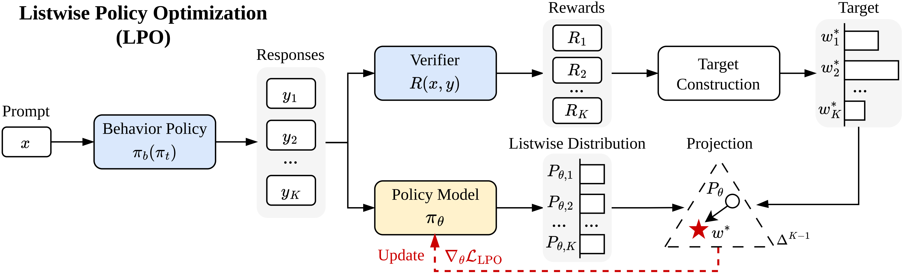

<h1 align="center">LPO: Listwise Policy Optimization</h1>

<p align="center">
  <strong>Group-based RLVR as Target-Projection on the LLM Response Simplex</strong><br>
  <strong>NeurIPS 2026</strong>
</p>

<p align="center">
  <a href="https://arxiv.org/abs/2605.06139"></a>
  <a href="https://huggingface.co/papers/2605.06139"></a>
</p>

This repository contains the official implementation of **[Listwise Policy Optimization (LPO)](https://arxiv.org/abs/2605.06139)** (NeurIPS 2026).
LPO is a novel explicit target-projection framework for Reinforcement Learning with Verifiable Rewards (RLVR) that demystifies the implicit target by restricting the proximal RL objective to the response simplex, and then projects the policy via exact divergence minimization.

Our implementation is built upon the [verl](https://github.com/verl-project/verl) framework.



## 🔧 Installation

Ensure you have **CUDA ≥ 12.4**, then run:

```bash
# Create and activate conda environment
conda create -n lpo python=3.10 -y
conda activate lpo

# Install dependencies
bash prepare.sh
```


## 📦 Dataset Preparation

We support multiple reasoning tasks. Below are a few examples to preprocess selected datasets.

```bash
# Mathematics dataset
python recipe/lpo/data_preprocess/math_dataset.py --local_dir='./data/math'

# Countdown
python recipe/lpo/data_preprocess/countdown.py --local_dir='./data/countdown'
```

## 📥 Download Pretrained Models

You can download models from [Hugging Face](https://huggingface.co/) as follows (example shown with Qwen3-1.7B-Base):

```bash
hf download Qwen/Qwen3-1.7B-Base --local-dir models/Qwen3-1.7B-Base
```

> Tip: You can change `--local-dir` to your own model path. Be sure to match it with your training configs.

## 🚀 Training

Training scripts are located in:

```bash
recipe/lpo/scripts/
```

These include task-specific scripts for launching LPO and baseline methods with different backbones and datasets.

Below is an example of how to launch LPO with forward KL training on the MATH task with Qwen3-1.7B-Base:


```bash
bash recipe/lpo/scripts/math/grpo_1.7b_lpo_fwd.sh
```

## Citation

If you use this code or find our work useful, please cite:

```bibtex
@misc{qu2026listwisepolicyoptimizationgroupbased,
      title={Listwise Policy Optimization: Group-based RLVR as Target-Projection on the LLM Response Simplex},
      author={Yun Qu and Qi Wang and Yixiu Mao and Heming Zou and Yuhang Jiang and Yingyue Li and Wutong Xu and Lizhou Cai and Weijie Liu and Clive Bai and Kai Yang and Yangkun Chen and Saiyong Yang and Xiangyang Ji},
      year={2026},
      eprint={2605.06139},
      archivePrefix={arXiv},
      primaryClass={cs.LG},
      url={https://arxiv.org/abs/2605.06139},
}
```
